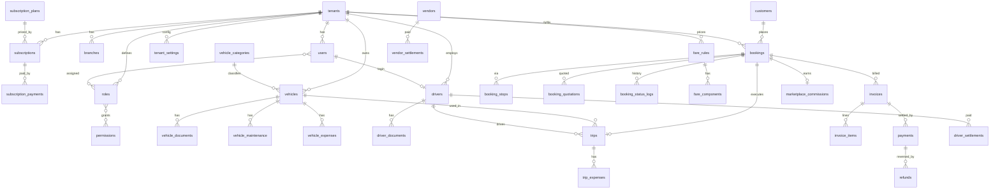

# Database Schema

Conventions: `id` BIGINT UNSIGNED PK; `timestamps`; money `DECIMAL(12,2)` INR; `T` = tenant-owned
(`tenant_id` FK → tenants, indexed, `BelongsToTenant` trait); `SD` = soft deletes.
Status ✅ = migrated (Phase 1), ⏳ = planned (phase noted).

## ERD (overview)

## SAAS
### tenants ✅
id, uuid (unique), name, slug (unique), legal_name, email, phone, gstin (nullable), pan,
address_line, city, state, pincode, logo_path, primary_color, status enum(pending, active,
suspended, rejected) idx, kyc_status enum(not_submitted, submitted, verified, rejected),
kyc_notes, approved_at, approved_by FK users, suspended_at, suspension_reason,
custom_domain (unique nullable, future), settings JSON, timestamps, SD.

### subscription_plans ✅
id, code (unique: starter/growth/business), name, description, price_monthly, price_yearly,
max_vehicles, max_drivers, max_branches, max_users, features JSON, trial_days, is_active,
sort_order, timestamps.

### subscriptions ✅ (T)
id, tenant_id, plan_id FK, billing_cycle enum(monthly,yearly,trial), status enum(trialing,
active, past_due, grace, expired, cancelled, suspended), starts_at, ends_at, grace_ends_at,
cancelled_at (all DATETIME, not TIMESTAMP — see DECISIONS D13), price DECIMAL, auto_renew, activated_by FK users nullable, notes, timestamps.
idx (tenant_id, status), idx ends_at.

Phase 2 additions to subscriptions ✅: reminder_stage (7/3/1 last reminder sent), superseded_by FK subscriptions
(renewal/upgrade chain; superseded rows expire quietly).

### subscription_payments ✅ (T, append-only)
id, tenant_id, subscription_id, invoice_number (unique, `ACT/<FY>/<00001>` from `sequences`), amount (excl. GST),
tax_percent, tax_amount, total, method (upi/bank_transfer/cash/cheque/razorpay/other), reference, gateway,
gateway_order_id, gateway_payment_id (unique nullable), status, paid_at, billing_snapshot JSON (seller/buyer/item
frozen at invoice time), recorded_by FK users, notes. idx (tenant_id, paid_at).

### sequences ✅
key (PK, e.g. `subscription_invoice:2026-27`, `support_ticket`), value. Row-locked gap-free counters.

### tenant_documents ✅ (T) — KYC
type (gst_certificate/pan_card/business_registration/owner_id_proof/address_proof/other), number, file_path
(private `local` disk, `kyc/<tenant uuid>/<random>`), original_name, mime, size, status (pending/approved/rejected),
review_notes, uploaded_by, reviewed_by, reviewed_at. idx (tenant_id, type).

### tenant_settings ✅ (T)
id, tenant_id, key, value TEXT, unique(tenant_id, key).

### platform_settings ✅
id, key (unique), value TEXT, is_secret bool, timestamps. Secret values stored encrypted.

## USERS
### users ✅
id, tenant_id nullable FK (NULL = platform/customer), type enum idx, name, email (unique
nullable), phone (unique nullable), password, status enum(active, inactive, blocked),
branch_id nullable (P3), last_login_at, last_login_ip, email_verified_at, phone_verified_at,
remember_token, timestamps, SD. Login by email OR phone.

### roles ✅
id, tenant_id nullable, name, slug, description, is_system bool, timestamps;
unique(tenant_id, slug).

### permissions ✅
id, key (unique, e.g. `vehicles.manage`), group, label.

### permission_role ✅ / role_user ✅
Composite PKs (permission_id, role_id) / (role_id, user_id).

### customers ⏳P5 — id, user_id nullable unique, name, phone idx, email, city, timestamps.
Platform-level (shared across operators); operators see customers via their bookings only.

### drivers ✅ (T, SD)
id, tenant_id, user_id unique nullable, branch_id, name, phone, licence_number,
licence_expiry, aadhaar_last4, address, status, is_available, rating, joined_on;
unique(tenant_id, phone).

### driver documents → `fleet_documents` (polymorphic)

## OPERATIONS
- branches ✅ (T, SD): name, code, city, address, phone, is_head_office, is_active; unique(tenant_id, code); users.branch_id FK.
- vehicle_categories ✅ (P3): tenant_id nullable (NULL = platform default), name, slug, seats_default.
- vehicles ✅ (T, SD): branch_id, vehicle_category_id, registration_number (normalised, unique per tenant), make, model,
  year, color, fuel_type, seats, is_ac, ownership (owned/attached/vendor), status (active/maintenance/inactive),
  is_available, insurance/permit/fitness/puc_expiry, odometer_km, image_path, notes.
- fleet_documents ✅ (T): polymorphic (vehicles & drivers) type, number, expires_on, private file — replaces
  separate vehicle_documents/driver_documents tables (D22).
- vehicle_maintenance ✅ (T): vehicle_id, service_date, type, description, odometer_km, cost, vendor, next_service_date/km.
- vehicle_expenses ✅ (T): vehicle_id, expense_date, category, amount, payment_method, reference, notes.

## BOOKINGS ✅ (P4) — see migration 2026_11_18_000004 for exact columns
- bookings (T): booking_number unique(tenant_id), customer_id, source enum(manual, website,
  marketplace, api, phone), type enum(local, outstation_oneway, outstation_round, airport,
  railway, hourly, full_day, corporate), status enum(enquiry, quoted, confirmed, advance_paid,
  vehicle_assigned, driver_assigned, started, completed, billed, settled, cancelled),
  pickup_address, pickup_lat/lng, drop_address, drop_lat/lng, pickup_at idx, return_at,
  vehicle_category_id, passengers, notes, fare_snapshot JSON, estimated_total, final_total,
  idempotency_key unique(tenant_id, idempotency_key), cancelled_at, cancel_reason.
- booking_stops, booking_quotations (fare breakdown JSON, valid_until, accepted_at),
  booking_status_logs (from, to, user_id, note).
- trips (T): booking_id unique, vehicle_id, driver_id, start_at, end_at (idx vehicle_id+start_at,
  driver_id+start_at), start_otp hash, start_km, end_km, started_at, completed_at.
- trip_expenses, trip_locations (lat, lng, recorded_at).

## PRICING ✅ (P4) — fare_rules implemented; fare_components/route_prices deferred (D26)
- fare_rules (T): vehicle_category_id, booking_type, base_fare, per_km, min_km, extra_km_rate,
  driver_allowance_per_day, night_charge, night_start, night_end, waiting_per_min,
  gst_percent, is_active; idx(tenant_id, vehicle_category_id, booking_type).
- fare_components (T): fare_rule_id, code, label, calc_type(fixed/percent/per_km), amount.
- route_prices (T): from_city, to_city, vehicle_category_id, trip_type, fixed_price.

## FINANCIAL ⏳P6 (all T, append-only)
invoices (invoice_number unique per tenant, booking_id, customer snapshot, gstin, subtotal,
tax, total, status, issued_at), invoice_items, payments (type: advance/balance/adjustment,
method, gateway ids unique, amount, status, reversal_of FK), refunds, expenses,
driver_settlements, vendor_settlements.

## MARKETPLACE ⏳P8
marketplace_listings (T), marketplace_commissions (T: booking_id unique, rate, amount, status),
vendors (T), vendor_vehicles (T).

## SYSTEM
- contact_messages ✅: name, email, phone, subject, message, type (contact | partner | enquiry), ip_address, handled_at.
- audit_logs ✅: tenant_id nullable idx, user_id nullable, event, auditable_type/id, old JSON,
  new JSON, ip, user_agent, created_at.
- notifications ✅ (Laravel database notifications).
- message_logs ⏳P9: channel, to, template, status, error, provider_message_id.
- support_tickets ✅ (T): number unique (TKT-000001), subject, category, priority, status (open/awaiting_customer/
  resolved/closed), created_by, assigned_to, last_reply_at, closed_at. idx (tenant_id, status), (status, last_reply_at).
- support_ticket_replies ✅ (T): support_ticket_id, user_id, from_staff, is_internal, body.
- contact_messages (Phase 2): + handled_by, admin_notes, idx (type, handled_at).
- payment_orders ✅ (T): purpose, plan_id, billing_cycle, amount, tax_amount, total, currency, gateway, gateway_mode,
  gateway_order_id unique, gateway_payment_id unique, status (created/paid/failed), subscription_payment_id,
  created_by, fulfilled_via (checkout/webhook), failure_reason, paid_at.
- message_logs ✅: tenant_id nullable, channel (mail/sms/whatsapp/push), provider, recipient, subject, body, status
  (sent/failed/skipped), provider_message_id, error, context.
- notification_templates ⏳P9.
- Framework: cache, cache_locks, jobs, job_batches, failed_jobs, sessions, password_reset_tokens ✅.

## Tenant isolation checklist
Every T table: `tenant_id` NOT NULL + FK + index (leading column on composite indexes);
unique constraints include `tenant_id`; model uses `BelongsToTenant`; exports/reports query
through scoped models only.

### Phase 4 actual tables
- fare_rules (T): vehicle_category_id, booking_type, base_fare, per_km, min_km, included_km/hours, extra_km_rate,
  extra_hour_rate, driver_allowance, night_charge, night_start/end, waiting_free_min, waiting_per_min, gst_percent, is_active;
  unique(tenant, category, type).
- bookings (T): booking_number unique(tenant), idempotency_key unique(tenant), source, type, status, payment_status,
  customer_*, pickup/drop, pickup_at, return_at, vehicle_category_id, passengers, distance_km, duration_min, rental_hours,
  quoted_total, final_total, amount_paid, fare_snapshot JSON, final_snapshot JSON, cancel_*, created_by.
- booking_stops, booking_quotations (version, breakdown JSON, total, valid_until, accepted_at), booking_status_logs.
- trips (T): booking_id unique, vehicle_id, driver_id, start_at/end_at window, status, start_otp (encrypted), start/end km, last_lat/last_lng/last_location_at (latest point only).
- drivers: + fcm_token (hidden), app_seen_at.
- payments (T, append-only): booking_id, kind (advance/balance/refund/adjustment), amount (negative = refund), method, reference, reversal_of.
